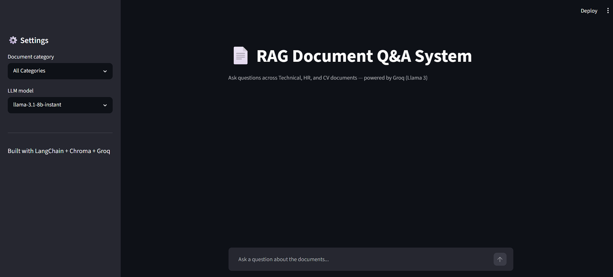
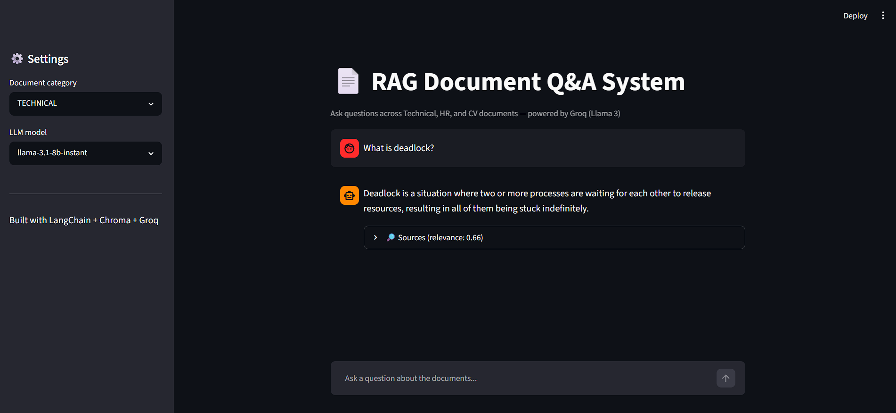
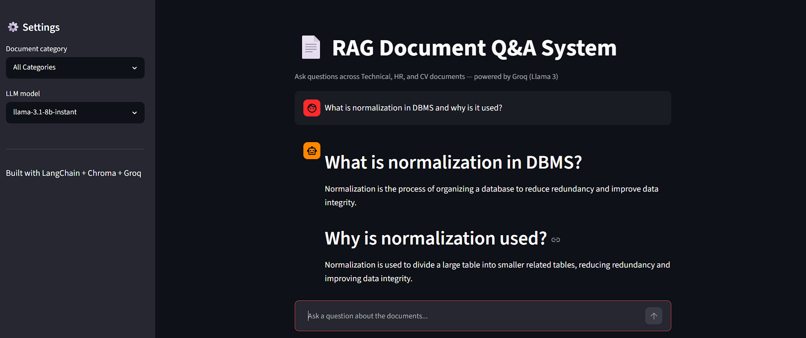
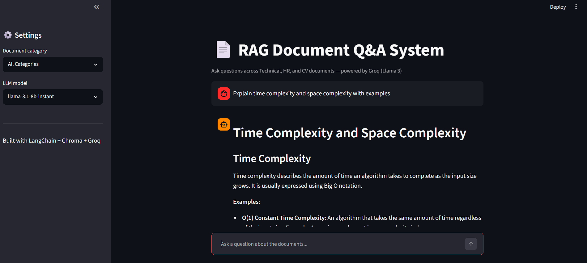

# RAG-Based Document Question Answering System

A Retrieval-Augmented Generation (RAG) system that answers questions from custom documents using semantic search and a cloud LLM — built with LangChain, ChromaDB, HuggingFace Embeddings, and Groq. Supports both a preloaded personal knowledge base and dynamic user-uploaded documents.

**Live demo:** [rag-document-qa-system-4moe.onrender.com](https://rag-document-qa-system-4moe.onrender.com/)

*Note: hosted on Render's free tier, which spins down after inactivity — the first request after idle may take 15–30+ seconds to respond while the container cold-starts.*

---

## Features

- Chat-style UI built with Streamlit
- **Two modes:**
  - **Preloaded mode** — semantic search over a personal knowledge base (Technical / HR / CV), with category-based filtering
  - **Upload mode** — upload your own PDF, DOCX, TXT, CSV, or MD file and ask questions about it, in an isolated per-session vector store
- HuggingFace sentence embeddings (free, runs locally, CPU-only)
- Fast LLM responses via Groq API (GPT-OSS 20B / GPT-OSS 120B)
- Q&A-block-based chunking for the preloaded knowledge base — each question/answer pair stays intact as a single retrievable unit
- Source chunk display with relevance scores
- Response caching (`st.cache_resource` / `st.cache_data`) — the vector DB connection and embedding model load once per process, and repeated identical questions skip the Groq API call
- Per-IP daily upload rate limiting (protects against abuse of the Groq free tier and embedding compute)
- File size cap (5MB), enforced both at the Streamlit server level and in application logic
- Dockerized for deployment on Render
- No OpenAI API key required

---

## Tech Stack

| Layer | Technology |
|---|---|
| Frontend | Streamlit |
| Vector Database | ChromaDB (persisted for preloaded mode, in-memory for uploads) |
| Embeddings | HuggingFace (all-MiniLM-L6-v2), CPU-only |
| LLM | Groq API (GPT-OSS 20B / GPT-OSS 120B) |
| Framework | LangChain |
| Deployment | Docker on Render |
| Language | Python |

---

## Project Structure

```
rag-document-qa-system/
├── app.py                  # Streamlit UI — mode toggle, chat, upload flow
├── create_database.py      # Builds persisted ChromaDB from data/ for preloaded mode
├── query_data.py           # RAG query logic, upload ingestion, rate limiting, Groq calls
├── compare_embeddings.py   # Embedding similarity utility
├── Dockerfile              # Container build for Render deployment
├── requirements.txt
├── README.md
├── .gitignore
├── .streamlit/
│   └── config.toml         # Server config (e.g. max upload size)
├── chroma/                 # Persisted vector DB for preloaded mode (auto-generated, gitignored)
├── screenshots/
│   ├── dashboard.png
│   ├── deadlock.png
│   ├── normalization.png
│   └── complexity.png
└── data/
    ├── technical.md         # Java, Python, DBMS, OS, DSA, Networking, Git
    ├── hr.md                # Personalized HR/behavioral interview answers
    └── cv.md                # First-person Q&A based on my resume and projects
```

Note: `.env`, `upload_log.json`, and `.streamlit/secrets.toml` are all gitignored and are not part of the repo — see **Setup** below for how to configure your own.

---

## How It Works

### Preloaded mode
1. Documents (`.md` files) are loaded from `data/` — each file becomes a category, based on its filename (e.g. `hr.md` → category `hr`)
2. Each document is split into chunks at every `## Question` heading, so a question and its full answer always stay together as one chunk
3. Chunks are converted to vector embeddings using HuggingFace `all-MiniLM-L6-v2` and stored in a persisted ChromaDB collection along with category metadata
4. On query, semantic similarity search retrieves the top candidate chunks, optionally filtered by category
5. Retrieved context is passed to Groq with a prompt instructing it to answer only from the provided context, in first person (since these are the candidate's own answers)
6. The vector DB connection and embedding model are cached at the process level, and repeated identical questions are cached for an hour to avoid redundant Groq calls

### Upload mode
1. User uploads a document (PDF, DOCX, TXT, CSV, or MD) — capped at 5MB
2. Upload is rate-limited to 2 per IP address per day, tracked in a local JSON log, to protect the Groq free tier and embedding compute from abuse
3. The file is loaded with the appropriate LangChain loader (`PyPDFLoader`, `Docx2txtLoader`, `CSVLoader`, or `TextLoader`), chunked, and embedded into a fresh **in-memory, non-persisted** ChromaDB vectorstore scoped to that browser session
4. For small documents (≤15 chunks), all chunks are used as context rather than relying on top-k similarity ranking — this avoids missing relevant content on vague queries against small files
5. A separate, neutral prompt (third person, no "you are the candidate" framing) is used so answers describe the uploaded document's subject rather than impersonating them
6. Uploading a new file replaces the currently active one — only one uploaded document is active per session at a time

---

## Setup

### 1. Clone the repository

```bash
git clone https://github.com/AnuvabPal7/rag-document-qa-system.git
cd rag-document-qa-system
```

### 2. Install dependencies

```bash
pip install -r requirements.txt
```

### 3. Set up your Groq API key

Get a free API key from [console.groq.com](https://console.groq.com/keys).

Create a `.env` file in the project root:

```dotenv
GROQ_API_KEY=your_key_here
```

(Alternatively, set `GROQ_API_KEY` as a system/environment variable, or use `.streamlit/secrets.toml` — the app checks all three.)

### 4. Build the preloaded vector database

```bash
python create_database.py
```

Re-run this any time `data/*.md` changes — it does not incrementally update, so delete the `chroma/` folder first if you want a clean rebuild.

### 5. Run the app

```bash
streamlit run app.py
```

---

## Usage

- Choose a **source**: preloaded knowledge base or upload your own document
- **Preloaded mode:** select a document category (Technical / HR / CV / All) and a model, then ask a question
- **Upload mode:** upload a file (max 5MB, 2 uploads/day per IP), then ask questions about it — answers stay grounded strictly in that document
- View the answer along with source chunks and relevance scores in the expandable panel

---

## Deployment (Docker + Render)

This app is containerized for deployment on [Render](https://render.com).

### Build and test locally

```bash
docker build -t rag-qa-app .
docker run --rm -p 8501:8501 -e GROQ_API_KEY="your_key_here" -e PORT=8501 --name rag-test rag-qa-app
```

Then open `http://localhost:8501`.

Note: the `Dockerfile` installs a CPU-only build of PyTorch before the rest of `requirements.txt`, to avoid pulling several GB of unused NVIDIA/CUDA packages that `sentence-transformers` would otherwise default to. It also pre-downloads the embedding model at **build time**, so cold starts don't pay the HuggingFace download cost on every container restart.

The `chroma/` persisted vector DB is gitignored and does not exist in a fresh container, so the Docker build also runs `create_database.py` at **image build time**, regenerating it from `data/*.md` inside the image itself. This means the deployed container is always self-contained — no reliance on a locally-built `chroma/` folder that only exists on the developer's machine.

### Deploy on Render

1. Push this repo to GitHub
2. On Render: **New → Web Service**, connect the repo
3. Render auto-detects the `Dockerfile` (Environment: Docker)
4. In the service's **Environment** tab, add `GROQ_API_KEY` with your actual key
5. Deploy

Render injects `$PORT` automatically at runtime — no manual configuration needed for that part, unlike local testing where it must be passed explicitly.

---

## 📸 Screenshots

### 🖥️ Dashboard


### 🔥 OS Question (Deadlock)


### 📊 DBMS Question (Normalization)


### 🧠 DSA Question (Complexity)


---

## Future Improvements

- Support multiple simultaneous uploaded documents per session instead of replacing the active one
- Add chat memory across sessions
- Add an evaluation page with retrieval precision metrics
- Add a re-ranking step on top of embedding similarity to improve retrieval accuracy on short or ambiguous queries
- Move the upload rate-limit log to a persistent store (e.g. SQLite on a mounted disk) so it survives Render container restarts, rather than a local JSON file on ephemeral storage
- Pin the daily rate-limit reset to a specific timezone instead of server-local (currently resets at UTC midnight on Render)

---

## Notes

- Embeddings are generated locally (no API cost)
- Only the LLM call uses Groq API (free tier is sufficient for demos)
- The persisted `chroma/` folder is auto-generated from `data/` — do not commit it
- Adding a new knowledge domain to the preloaded base is as simple as dropping a new `.md` file (with `## Question` headers) into `data/` and re-running `create_database.py`
- The `cv.md` and `hr.md` files contain my own answers written in first person, based on my actual resume and project experience — they're meant to demonstrate the RAG system answering personalized, real-world interview-style questions
- Uploaded documents are never persisted to disk beyond a temporary file used during ingestion, and the resulting vectorstore is memory-only and session-scoped — nothing about an uploaded document is written to the repo's persisted `chroma/` folder or shared across users